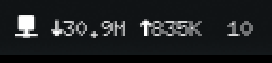

# Deco Monitor



An Omarchy shell bar widget for a TP-Link Deco mesh: total download and upload
across your home network, and how many devices are connected. Click it for a
panel with:

- a speed graph of the last few minutes
- every Deco unit with its online and internet status, plus the Deco's CPU and RAM
- the busiest devices right now
- a button that opens the full **Deco Monitor** app

The widget never talks to the Deco itself. It reads the status file written by
the `deco-monitor` service from
[deco-monitor](https://github.com/hell0world69/deco-monitor), which also has
the desktop app (device list, block and unblock, reboot) and the setup steps.

## Install

1. Install [deco-monitor](https://github.com/hell0world69/deco-monitor) and
   start its service.
2. Clone the widget:

```bash
git clone https://github.com/hell0world69/omarchy-deco-monitor.git ~/.config/omarchy/plugins/hell0world.deco-monitor
```

Then add `{ "id": "hell0world.deco-monitor" }` to a section of `bar.layout` in
`~/.config/omarchy/shell.json`, or run
`omarchy bar put hell0world.deco-monitor`.

## Settings

| Key | Default | Meaning |
|-----|---------|---------|
| `showSpeed` | `true` | Show total download and upload in the bar |
| `showCount` | `true` | Show the number of connected devices in the bar |

MIT licensed. Not affiliated with TP-Link.
